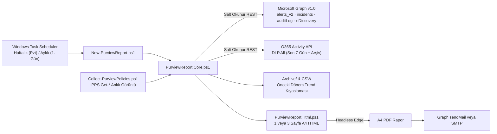

<p align="center">
  <picture>
    <source media="(prefers-color-scheme: dark)" srcset="./assets/banner-dark.svg" />
    <source media="(prefers-color-scheme: light)" srcset="./assets/banner-light.svg" />
    
  </picture>
</p>

<p align="center">
  <a href="https://github.com/canercetinkaya/purview-executive-reporting/actions/workflows/ci.yml"></a>
  
  
  
  <a href="./LICENSE"></a>
</p>

---

**Purview Executive Reporting**, Microsoft Purview ortamları için **haftalık veri güvenliği özeti (1 sayfa)** ve **aylık yönetim raporu (3 sayfa, önceki dönem trend kıyaslamalı)** üreten, **Windows Task Scheduler** ile tam otomatik çalışan saf PowerShell raporlama servisidir.

Web sunucusu, veritabanı, Docker, Power BI veya Power Automate gerektirmez. Doğrudan Microsoft Graph Security v2, Office 365 Management Activity API (`DLP.All`) ve salt okunur Purview IPPS (`Get-*`) envanteri üzerinden veri toplar, A4 HTML/PDF üretir ve otomatik e-posta ile iletir.

---

## Nasıl Çalışır?



---

## Temel Yetenekler

- **Tek Ekran Kurulum Sihirbazı (`Install-PurviewReport.ps1`):** Entra ID uygulama kaydını açar, salt okunur API izinlerini ekleyip yönetici onayını verir, gizli anahtarı makineye bağlı **DPAPI** (`secret.txt`) ile şifreler, 8 adımlı erişim testini koşar ve **Windows Task Scheduler (S4U)** görevlerini kurar.
- **Çift Raporlama Modu:**
  - **Haftalık Özet (`-Mode Weekly`):** 1 sayfalık yönetici özeti; DLP politika durumu, son 7 günün `DLP.All` olayları, Purview uyarıları, Veri Kaynağı Sağlık Matrisi ve haftalık veriyi arşivleme (aylık raporun `DLP.All` hafızasını besler).
  - **Aylık Yönetim Raporu (`-Mode Monthly`):** 3 sayfalık A4 baskı dostu rapor; yönetici özeti, **önceki aya göre kıyaslamalı KPI tablosu**, iş yükü kapsam çubukları, incident şiddet dağılımı, aktif DLP politikaları ve gelecek ay için öncelikli aksiyon önerileri.
- **Şeffaf Veri Kaynağı Durumu:** İzin eksikliği veya lisans sınırı nedeniyle alınamayan hiçbir metrik sahte sıfır olarak gösterilmez; her kaynak `Erişilebilir`, `Kısmi Veri`, `Yetki Eksik`, `Lisanssız` veya `IPPS Anlık Görüntüsü Gerekli` etiketiyle açıkça raporlanır.
- **Güvenlik Sıkılaştırması:** Hiçbir `Set-*`, `New-*` veya `Remove-*` komutu çalıştırmaz. Tüm HTML çıktıları `ConvertTo-HtmlSafe` ile XSS kaçışından geçer ve sıkı çevrimdışı CSP (`default-src 'none'`) taşır.

---

## 3 Adımda Hızlı Kurulum

```powershell
# 1. Projeyi indirin ve kısa bir klasöre alın (ör. C:\PurviewReport)
cd C:\PurviewReport
Set-ExecutionPolicy -Scope Process -ExecutionPolicy Bypass -Force
Get-ChildItem *.ps1 | Unblock-File

# 2. Tek ekran sihirbazını başlatın (veya Kurulum-Baslat.cmd'ye çift tıklayın)
.\Install-PurviewReport.ps1
```

Mevcut bir Entra ID uygulamanız varsa:

```powershell
.\Install-PurviewReport.ps1 -UseExistingApp
```

---

## Günlük Kullanım ve Doğrulama

```powershell
# 8 adımlı salt okunur bağlantı testi
.\New-PurviewReport.ps1 -Test

# IPPS üzerinden DLP, Etiket, İç Tehdit ve Saklama politika envanterini güncelle (yalnızca Get-*)
.\Collect-PurviewPolicies.ps1 -Organization kiraci.onmicrosoft.com

# Mail göndermeden deneme raporu (HTML + A4 PDF)
.\New-PurviewReport.ps1 -Mode Weekly  -DryRun -Pdf
.\New-PurviewReport.ps1 -Mode Monthly -DryRun -Pdf -ExportCsv

# Üretim çalıştırması (HTML + PDF + E-posta)
.\New-PurviewReport.ps1 -Mode Monthly -Pdf
```

---

## Minimum Yetki Düzeyleri (En Az Ayrıcalık)

| Kaynak | Uygulama İzni | Kapsam |
| :--- | :--- | :--- |
| Microsoft Graph | `SecurityAlert.Read.All` | Graph Security `alerts_v2` uyarıları (Purview ve M365) |
| Microsoft Graph | `SecurityIncident.Read.All` | Güvenlik olayları (`$top=50`), kapanış süresi ve sınıflandırma |
| Microsoft Graph | `AuditLogsQuery.Read.All` | Purview denetim günlüğü sorguları (lisans dahilinde) |
| Microsoft Graph | `InformationProtectionPolicy.Read.All` | Hassasiyet etiketi politikası kapsam doğrulaması |
| Microsoft Graph | `eDiscovery.Read.All` *(isteğe bağlı)* | eDiscovery vaka özeti (E5 / Purview eDiscovery lisansı gerektirir) |
| O365 Management API | `ActivityFeed.Read` | `DLP.All` olay kayıtları ve politika eşleşme özetleri |
| Microsoft Graph | `Mail.Send` *(isteğe bağlı)* | Yalnızca Graph ile mail seçildiğinde eklenir; tek posta kutusuna kısıtlanması önerilir |
| Purview IPPS (`Get-*`) | Global Reader / Compliance Reader | `Collect-PurviewPolicies.ps1` için salt okunur politika envanteri |

> Kurulum sihirbazı yalnızca **kurulum anında** geçici cihaz kodu akışıyla `Application.ReadWrite.All` + `AppRoleAssignment.ReadWrite.All` kullanır; oluşturulan servis uygulaması ise hiçbir yazma yetkisi taşımaz.

---

## Dokümantasyon ve Testler

- [Kurulum, Sertifika Kullanımı ve Geri Dönüş Kılavuzu](docs/KURULUM.md)
- [Mimari Tasarım ve 3 Sayfalık KPI Kataloğu](docs/ARCHITECTURE.md)
- [Örnek Yapılandırma Dosyası (`customer.example.json`)](customer.example.json)

```powershell
# PSScriptAnalyzer statik kod analizi ve Pester 5 testleri
Invoke-ScriptAnalyzer -Path . -Recurse -Settings .\PSScriptAnalyzerSettings.psd1
Invoke-Pester -Path .\tests -Output Detailed
```

---

## Lisans

Bu proje [MIT Lisansı](LICENSE) altında açık kaynak olarak sunulmaktadır.
