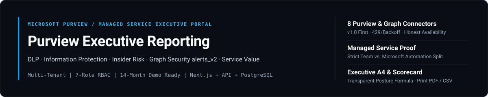
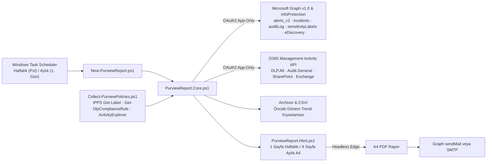

<p align="center">
  <picture>
    <source media="(prefers-color-scheme: dark)" srcset="./assets/banner-dark.svg" />
    <source media="(prefers-color-scheme: light)" srcset="./assets/banner-light.svg" />
    
  </picture>
</p>

<p align="center">
  <a href="https://github.com/canercetinkaya/purview-executive-reporting/actions/workflows/ci.yml"></a>
  
  
  
  <a href="./LICENSE"></a>
</p>

---

**Purview Executive Reporting**, Microsoft Purview ortamları için **haftalık operasyon özeti (1 sayfa A4)** ve **aylık kapsamlı yönetici ve teknik rapor (4 sayfa A4, önceki dönem trend kıyaslamalı)** üreten, **Windows Task Scheduler** ile tam otomatik çalışan saf PowerShell raporlama servisidir.

Web sunucusu, veritabanı, Docker, Power BI veya Power Automate gerektirmez. Doğrudan Microsoft Graph Security v2, Microsoft Graph Information Protection, Office 365 Management Activity API (`DLP.All`, `Audit.General`, `Audit.SharePoint`, `Audit.Exchange`) ve salt okunur Purview IPPS (`Get-*` / `Export-ActivityExplorerData`) üzerinden veri toplar, A4 HTML/PDF üretir ve otomatik e-posta ile iletir.

---

## Raporlarda Neler Yer Alır?

### Aylık Yönetim ve Teknik Raporu (`-Mode Monthly` — 4 Sayfa A4)
1. **Sayfa 1 — Yönetici Özeti ve Purview Koruma Kapsamı:**
   - Dönem anlatımı, önceki aya göre değişim özeti ve eşik tabanlı **Dikkat Gerektiren Başlıklar**
   - 6 Ana KPI Kartı (DLP Politikaları, DLP Olayları, Engel / Kullanıcı Override, Aktif Hassasiyet Etiketleri, Etiket İşlemleri, Açık / Toplam Incident)
   - DLP İş Yükü Kapsamı çubuk grafiği, Veri Yönetişimi özeti ve **7 Katmanlı Veri Kaynağı Sağlık Matrisi**
2. **Sayfa 2 — Hassasiyet Etiketleri (Sensitivity Labels) ve Bilgi Koruma Analizi:**
   - Kiracıdaki tüm **Hassasiyet Etiketi Envanteri** (`Personal`, `Public`, `General`, `Confidential`, `Highly Confidential`, özel kritik etiketler ör. `RECETE`), öncelik seviyesi, şifreleme/filigran durumu ve politika açıklaması
   - **Etiket Bazlı Kullanım Dağılımı:** Hangi etiket kaç kez **uygulandı (`Applied`)**, kaç kez **değiştirildi/düşürüldü (`Changed / Downgraded`)**, kaç kez **kaldırıldı (`Removed`)**
   - **En Çok Etiket İşlemi Yapan Kullanıcılar** ve iş yükü dağılımı (`SharePoint`, `OneDrive`, `Exchange`, `Endpoint`)
3. **Sayfa 3 — DLP Kural Eşleşmeleri, Hassas Bilgi Türleri (SIT) ve Kullanıcı Analizi:**
   - **En Çok Eşleşen DLP Politikaları ve Kuralları:** Politika adı, eşleşen kural, şiddet, aksiyon (`Engellendi [Block]`, `Kullanıcı Override`, `Bildirim`, `Denetim`), olay ve override sayıları
   - **En Çok Eşleşen Hassas Bilgi Türleri (SIT):** `T.C. Kimlik Numarası (TCKN)`, `Credit Card Number`, `TR IBAN`, `Sağlık / Reçete Verisi`, `Kaynak Kod & API Anahtarı` vb. olay ve tespit edilen örnek adetleri
   - **En Çok DLP Tetikleyen Kullanıcılar (Top Users):** Kullanıcı UPN, toplam eşleşme, yüksek şiddetli olay, engellenen, **override sayısı ve kullanıcının girdiği son override gerekçesi**
   - **DLP İş Yükü Dağılımı** (`Exchange`, `SharePoint`, `OneDrive`, `Microsoft Teams`, `Endpoint`, `Copilot / AI`)
4. **Sayfa 4 — Dönem Trendi, Politika Envanteri ve Öncelikli Aksiyon Planı:**
   - **Önceki Dönemle Karşılaştırmalı KPI Tablosu** (`Bu Dönem` | `Önceki Dönem` | `Değişim %`)
   - **Aktif DLP Politika Envanteri** (Politika, Kip, İş Yükü, Korunan SIT Türleri, Son Güncelleme)
   - **Son Purview & M365 Güvenlik Uyarıları (`alerts_v2`)**, en sık denetim operasyonları ve **Gelecek Ay İçin Öncelikli Aksiyonlar**

### Haftalık Operasyon Özeti (`-Mode Weekly` — 1 Sayfa A4)
- Tek sayfada 6 KPI kartı, dikkat gerektiren başlıklar, en çok eşleşen DLP kuralları, en çok DLP/denetim tetikleyen kullanıcılar, hassasiyet etiketi kullanım özeti ve veri kaynağı sağlık matrisi.

### Hazır Örnek Raporlar (`samples/`)
- [Örnek Aylık 4 Sayfalık Purview Raporu (HTML)](samples/Contoso_Ornek_Purview_Aylik_Rapor.html)
- [Örnek Haftalık 1 Sayfalık Purview Özeti (HTML)](samples/Contoso_Ornek_Purview_Haftalik_Rapor.html)

---

## Nasıl Çalışır? (Çok Katmanlı Toplama Mimarisi)



---

## 3 Adımda Hızlı Kurulum ve Çalıştırma

```powershell
# 1. Klasöre geçin ve dosya engelini kaldırın
cd C:\PurviewReport
Set-ExecutionPolicy -Scope Process -ExecutionPolicy Bypass -Force
Get-ChildItem *.ps1 | Unblock-File

# 2. Tek ekran kurulum sihirbazını çalıştırın (veya Kurulum-Baslat.cmd'ye çift tıklayın)
.\Install-PurviewReport.ps1
```

### Günlük Kullanım Komutları

```powershell
# 1. Tüm tabloları dolu örnek kurumsal raporu (Aylık 4 sayfa + Haftalık 1 sayfa) hemen üretip görmek için:
.\New-PurviewReport.ps1 -Mode Monthly -SampleDemo -DryRun -Pdf
.\New-PurviewReport.ps1 -Mode Weekly  -SampleDemo -DryRun -Pdf

# 2. Canlı kiracınızda 9 adımlı bağlantı ve yetki doğrulaması:
.\New-PurviewReport.ps1 -Test

# 3. IPPS üzerinden DLP kuralları, SIT'ler, Hassasiyet Etiketleri ve Activity Explorer verisini çekmek için:
.\Collect-PurviewPolicies.ps1 -Organization kiraci.onmicrosoft.com -IncludeAuditTelemetry

# 4. Canlı kiracınız için Aylık (4 sayfa) ve Haftalık (1 sayfa) HTML + PDF + CSV üretimi:
.\New-PurviewReport.ps1 -Mode Monthly -DryRun -Pdf -ExportCsv
.\New-PurviewReport.ps1 -Mode Weekly  -DryRun -Pdf

# 5. Üretim çalıştırması (HTML + A4 PDF + Otomatik E-posta):
.\New-PurviewReport.ps1 -Mode Monthly -Pdf
```

---

## Minimum Yetki Düzeyleri ve Kimlik Doğrulama Yöntemleri

Servis **3 farklı kimlik doğrulama ve bağlantı katmanını** bir arada destekler:

1. **OAuth2 İstemci Gizli Anahtarı (`AuthMode: Secret` + Windows DPAPI `secret.txt`):** Graph API ve Office 365 Management Activity API çağrıları için katılımsız çalışır.
2. **OAuth2 X.509 Sertifikası (`AuthMode: Certificate`):** Hem Graph ve O365 Activity API, hem de **%100 katılımsız `Connect-IPPSSession -AppId -CertificateThumbprint -Organization`** için önerilen kurumsal yöntemdir.
3. **Etkileşimli / Delegated IPPS (`Collect-PurviewPolicies.ps1`):** Sertifika olmadan isteğe bağlı çalıştırıldığında yönetici oturumuyla politika ve kural envanterini günceller.

| Kaynak | Uygulama İzni | Kapsam |
| :--- | :--- | :--- |
| Microsoft Graph | `SecurityAlert.Read.All` | Graph Security `alerts_v2` uyarıları (Purview ve M365) |
| Microsoft Graph | `SecurityIncident.Read.All` | Güvenlik olayları (`$top=50`), kapanış süresi ve sınıflandırma |
| Microsoft Graph | `InformationProtectionPolicy.Read.All` | Kiracıdaki Hassasiyet Etiketi (`Sensitivity Labels`) tanımları ve öncelikleri |
| Microsoft Graph | `AuditLogsQuery.Read.All` | Purview birleşik denetim günlüğü sorguları (30-180 gün) |
| Microsoft Graph | `RecordsManagement.Read.All` | Kayıt yönetimi ve saklama etiketleri |
| Microsoft Graph | `eDiscovery.Read.All` *(isteğe bağlı)* | eDiscovery vaka özeti (E5 / Purview eDiscovery lisansı varsa) |
| O365 Management API | `ActivityFeed.Read` | `Audit.General`, `Audit.SharePoint`, `Audit.Exchange` (Etiket kullanımı ve denetim) |
| O365 Management API | `ActivityFeed.ReadDlp` | `DLP.All` (Eşleşen DLP kuralları, SIT'ler, tetikleyen kullanıcılar ve override gerekçeleri) |
| Exchange / IPPS | `Exchange.ManageAsApp` + `Compliance Reader` | Katılımsız `Connect-IPPSSession` (`Get-Label`, `Get-DlpComplianceRule`, `Export-ActivityExplorerData`) |
| Microsoft Graph | `Mail.Send` *(isteğe bağlı)* | Yalnızca Graph ile mail gönderimi seçildiğinde eklenir |

---

## Dokümantasyon ve Doğrulama Testleri

- [Kurulum, X.509 Sertifika ile Katılımsız IPPS ve Geri Dönüş Kılavuzu](docs/KURULUM.md)
- [Mimari Tasarım ve 4 Sayfalık KPI Kataloğu](docs/ARCHITECTURE.md)
- [Örnek Yapılandırma Dosyası (`customer.example.json`)](customer.example.json)

```powershell
# PSScriptAnalyzer statik kod analizi ve Pester 5 testleri
Invoke-ScriptAnalyzer -Path . -Recurse -Settings .\PSScriptAnalyzerSettings.psd1
Invoke-Pester -Path .\tests -Output Detailed
```

---

## Lisans

Bu proje [MIT Lisansı](LICENSE) altında açık kaynak olarak sunulmaktadır.
