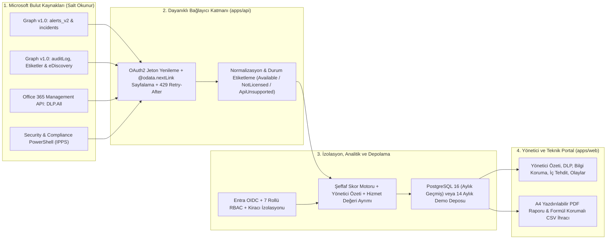

<p align="center">
  <picture>
    <source media="(prefers-color-scheme: dark)" srcset="./assets/banner-dark.svg" />
    <source media="(prefers-color-scheme: light)" srcset="./assets/banner-light.svg" />
    
  </picture>
</p>

<p align="center">
  <a href="https://github.com/canercetinkaya/purview-executive-reporting/actions/workflows/ci.yml"></a>
  
  
  
  <a href="./LICENSE"></a>
</p>

---

**Microsoft Purview Yönetilen Hizmet Yönetici Raporlama Portalı**, kurumlara Microsoft Purview hizmeti sunan güvenlik ekipleri (MSSP / İç SecOps) için geliştirilmiş, **çok kiracılı (multi-tenant)** bir yönetici ve uyumluluk raporlama platformudur.

Amaç karmaşık teknik günlükleri alt alta dökmek değildir. Bir **CISO, CIO, Uyum Yöneticisi veya Veri Koruma Sorumlusunun yaklaşık 5 dakika içinde** şu 4 soruya net yanıt almasını sağlar:

1. **Bu ay ortamda ne değişti?** (DLP olayları, dış paylaşımlar, duyarlılık etiketi kullanımı, iç tehditler, iletişim uyumluluğu ve güvenlik olayları)
2. **Durum iyiye mi kötüye mi gidiyor?** (Önceki ay, 3 ay, 6 ay ve 12 aylık karşılaştırmalı eğilim grafikleri ve şeffaf puan kartı)
3. **Yönetilen hizmet ekibi müşteri için fiilen ne yaptı?** (Ekibin incelediği olaylar, kapattığı vakalar, azalttığı yanlış pozitifler ve yaptığı politika iyileştirmeleri — Microsoft'un otomatik bulut tespitlerinden kesin olarak ayrı tutulur)
4. **Hangi veriye gerçekten erişilebiliyor, hangisi eksik?** (Yetki eksikse `PermissionMissing`, lisans yoksa `NotLicensed`, Microsoft API'si henüz sunmuyorsa `ApiUnsupported` olarak dürüstçe gösterilir; asla sahte sayı üretilmez)

---

## Sistem Nasıl Çalışır?

Platform dört bağımsız katmanda çalışır. Veri toplama katmanı yalnızca **okuma** yetkisiyle Microsoft servislerinden sinyalleri alır, aylık anlık görüntülere dönüştürüp kiracı bazlı izole biçimde saklar ve hem yönetici ekranı hem de yazdırılabilir A4 PDF / CSV raporları üretir.



### 4 Adımda Çalışma Akışı

1. **Veri Toplama (`connectors/`):**
   - Her Microsoft servisi ortak bir arayüz üzerinden (`Initialize`, `ValidatePermissions`, `TestConnection`, `Collect`, `Normalize`, `GetHealth`) çalışır.
   - Emekli edilmiş `/security/alerts` yerine güncel **`/v1.0/security/alerts_v2`** ve **`/v1.0/security/incidents`** uç noktaları kullanılır.
   - HTTP `429` hız sınırlarında `Retry-After` başlığı beklenir, geçici `5xx` hatalarında üstel geri çekilme uygulanır ve tüm sayfalar `@odata.nextLink` ile toplanır.
2. **Dürüst Durum Etiketleme:**
   - Bir bağlayıcıda yetki eksikse **`PermissionMissing`**, kiracıda lisans yoksa **`NotLicensed`**, önizleme API'si kullanılıyorsa **`BetaDependency`**, Microsoft'un API ile henüz sunmadığı bir metrikse (örneğin SharePoint/OneDrive'da bekleyen etiketsiz dosyaların tam sayımı) **`ApiUnsupported`** gösterilir.
3. **Analitik ve Emek Ayrımı (`analytics/`):**
   - **Şeffaf Duruş Puanı:** 5 ağırlıklı bileşenden (%25 DLP Risk Kontrolü, %25 Olay Çözüm Verimliliği, %20 Etiketleme Yönetişimi, %15 İç Tehdit ve İletişim Riski, %15 Bağlayıcı/Denetim Hijyeni) hesaplanır. Kullanıcı arayüzdeki **Formula** düğmesine tıklayıp tüm formülü ve kaynak değerleri görebilir; bir kaynak eksikse puan uydurulmaz, kalan ağırlıklar %100'e yeniden oranlanır.
   - **Hizmet Değeri Ayrımı:** Microsoft'un otomatik tespit/engelleme sayıları ile yönetilen hizmet analistlerinin insan emeği hiçbir yerde toplanıp karıştırılmaz.
4. **Sunum ve Raporlama (`apps/web`):**
   - Müşteri seçici, ay seçici ve karşılaştırma aralığı (`MoM`, `3M`, `6M`, `12M`) ile yönetici özetinden tek tek politikalara detay inilir; ay sonunda tek tıkla A4 PDF veya Excel'de formül enjeksiyonuna karşı korumalı CSV alınır.

---

## Minimum Yetki Düzeyleri (En Az Ayrıcalık Prensibi)

Bu platform hem **Microsoft tarafında (veri toplama)** hem de **portal içinde (kullanıcı erişimi)** en az ayrıcalık ilkesini zorunlu kılar.

### A) Microsoft Entra ID ve M365 API İzinleri (Yalnızca Okuma)

Veri toplama uygulamasında hiçbir `ReadWrite`, cihaz izole etme, kural değiştirme veya vaka silme izni **talep edilmez**:

| Servis / Kaynak | Minimum İzin (Application) | Neden Gerekli? |
| :--- | :--- | :--- |
| **Microsoft Graph** | `SecurityAlert.Read.All` | `/v1.0/security/alerts_v2` üzerinden Purview DLP, İç Tehdit ve İletişim Uyumluluğu uyarılarını okumak için |
| **Microsoft Graph** | `SecurityIncident.Read.All` | `/v1.0/security/incidents` üzerinden olay durumlarını ve ortalama/medyan çözüm sürelerini (MTTR) hesaplamak için |
| **Microsoft Graph** | `AuditLogsQuery.Read.All` *(veya iş yükü bazlı `AuditLogsQuery-Exchange/SharePoint/OneDrive/Endpoint.Read.All`)* | `/v1.0/security/auditLog/queries` ile birleşik denetim ve etiketleme olaylarını sorgulamak için |
| **Microsoft Graph** | `InformationProtectionPolicy.Read.All` | Kiracıdaki duyarlılık etiketlerini (`/v1.0/security/informationProtection/sensitivityLabels`) listelemek için |
| **Microsoft Graph** | `RecordsManagement.Read.All` | Saklama etiketlerini (`/v1.0/security/labels/retentionLabels`) okumak için |
| **Microsoft Graph** | `eDiscovery.Read.All` | Aktif/kapanan eDiscovery vakalarını (`/v1.0/security/cases/ediscoveryCases`) okumak için |
| **Office 365 Management API** | `ActivityFeed.Read` | `DLP.All` akışından Exchange, SharePoint, OneDrive, Teams ve Endpoint DLP olaylarını toplamak için |
| **Security & Compliance PowerShell** | `Exchange.ManageAsApp` + Entra `Global Reader` *(veya `Compliance Administrator`)* | `Invoke-PurviewComplianceCollect.ps1` betiğinin sertifika ile oturum açıp yalnızca `Get-*` politika ayarlarını alması için |

> **Önemli Güvence:** `Invoke-PurviewComplianceCollect.ps1` içinde hiçbir `Set-*`, `New-*` veya `Remove-*` komutu bulunmaz; bu kural Pester testleriyle otomatik denetlenir.

### B) Portal İçi Kullanıcı Yetki Matrisi (7 Rollü RBAC + Kiracı İzolasyonu)

Yetkiler yalnızca arayüzde değil, doğrudan API katmanında sunucu tarafında (`assertPermission` ve `assertCustomerAccess`) zorunlu tutulur:

| Rol | Kiracı Kapsamı | Portal Okuma | Rapor İhracı (CSV/JSON) | Hizmet Aktivitesi / Öneri Güncelleme | Toplama Tetikleme & Yönetim |
| :--- | :--- | :---: | :---: | :---: | :---: |
| `PlatformAdmin` | Tüm yetkili müşteriler | ✅ | ✅ | ✅ | ✅ |
| `ServiceManager` | Tüm yetkili müşteriler | ✅ | ✅ | ✅ | ✅ |
| `SecurityAnalyst` | Tüm yetkili müşteriler | ✅ | ✅ | ✅ | Yalnızca toplama |
| `ComplianceAnalyst` | Tüm yetkili müşteriler | ✅ | ✅ | ✅ | Yalnızca toplama |
| `CustomerAdministrator` | **Yalnızca kendi kurumu** | ✅ | ✅ | Yalnızca öneri durumu | Yalnızca kendi ayarlarını okuma |
| `CustomerExecutive` | **Yalnızca kendi kurumu** | ✅ | ✅ | ❌ | ❌ |
| `CustomerReader` | **Yalnızca kendi kurumu** | ✅ | ❌ | ❌ | ❌ |

Bir müşteri kullanıcısı (`CustomerExecutive`, `CustomerReader`, `CustomerAdministrator`) URL veya API isteği değiştirerek başka bir kurumun verisine erişmeye çalıştığında API doğrudan **`HTTP 403 TENANT_ISOLATION_DENIED`** döner.

---

## Hızlı Başlangıç (Demo Modu — 2 Dakikada Yerelde Çalıştır)

Canlı Microsoft kiracısına veya harici veritabanına ihtiyaç duymadan tüm portali 14 aylık gerçekçi örnek veriyle inceleyebilirsiniz:

```bash
git clone https://github.com/canercetinkaya/purview-executive-reporting.git
cd purview-executive-reporting
npm install
npm run build
npm run dev
```

- **Web Portalı:** `http://localhost:3010`
- **API Sağlık Kontrolü:** `http://127.0.0.1:4010/health`

Demo modunda sayfa üstünde belirgin **DEMO DATA** şeridi gösterilir ve 2 ayrı izole örnek kurum sunulur:
- **Contoso Financial Group:** Tam E5 Purview kurulumu (14 aylık trend, Graph Beta etiket uyarısı ve etiketsiz dosya envanteri için açık `ApiUnsupported` bildirimi).
- **Northwind Health Systems:** Lisanssız modüllerde **`NotLicensed`** ve onayı bekleyen izinlerde **`PermissionMissing`** davranışını canlı gösterir.

Üst menüdeki **Active Demo RBAC Persona** seçicisini değiştirerek kiracı izolasyonunu ve rol kısıtlamalarını anında test edebilirsiniz.

---

## Gerçek veya Test Kiracısını 2 Komutta Bağlama (`DATA_PROVIDER=live`)

PostgreSQL veya Docker kurmadan, gerçek kiracınızdaki canlı Microsoft Graph + DLP.All + IPPS verisiyle raporu hemen görmek için:

```powershell
# 1. Tek seferlik salt okunur uygulama kaydı ve .env kurulumu:
.\collectors\powershell\Setup-PurviewTestTenant.ps1 -Organization <alan-adiniz.onmicrosoft.com>

# 2. (İsteğe bağlı) Purview politika envanteri (DLP/Etiket/İç Tehdit modları):
.\collectors\powershell\Invoke-PurviewComplianceCollect.ps1 -CustomerId cust-test-tenant -Organization <alan-adiniz.onmicrosoft.com>

# 3. Portalı başlatın -> http://localhost:3010
npm run dev
```

*(Kalıcı kurumsal üretim kurulumu için PostgreSQL 16 + `docker compose up -d --build` + `AUTH_MODE=entra` adımları [DEPLOYMENT.md](docs/DEPLOYMENT.md) dosyasındadır.)*

---

## Doğrulama ve Test Komutları

```bash
npm run verify   # Typecheck + ESLint + Vitest (18 test) + API & Web üretim derlemesi
npm run test:ps  # PowerShell toplayıcı Pester testleri (salt okunur ve şema doğrulaması)
```

---

## Teknik Dokümantasyon

| Doküman | İçerik |
| :--- | :--- |
| [ARCHITECTURE.md](docs/ARCHITECTURE.md) | Katmanlı monorepo mimarisi, veritabanı tasarımı ve teknoloji gerekçeleri |
| [MICROSOFT-DATA-SOURCES.md](docs/MICROSOFT-DATA-SOURCES.md) | Her metriğin resmî Microsoft Learn API / PowerShell / Desteklenmeyen durumu |
| [GRAPH-PERMISSIONS.md](docs/GRAPH-PERMISSIONS.md) | En az ayrıcalıklı Graph ve O365 izinleri ile kiracı bağlama adımları |
| [SECURITY.md](docs/SECURITY.md) & [THREAT-MODEL.md](docs/THREAT-MODEL.md) | OWASP Top 10 / API Top 10 tehdit modeli, RBAC, log redaksiyonu ve CSV koruması |
| [REPORTING-METHODOLOGY.md](docs/REPORTING-METHODOLOGY.md) | Şeffaf puan formülü, ağırlıklar, RAG hedefleri ve anlatı kuralları |
| [INSTALLATION.md](docs/INSTALLATION.md) & [DEPLOYMENT.md](docs/DEPLOYMENT.md) | Yerel kurulum, Docker Compose, PostgreSQL ve Azure Key Vault dağıtımı |
| [METRIC-CATALOG.md](docs/METRIC-CATALOG.md) | Puan kartı metrik tanımları ve hedef eşikleri |
| [TESTING.md](docs/TESTING.md) & [TROUBLESHOOTING.md](docs/TROUBLESHOOTING.md) | Test kapsamı ve HTTP 429 / 403 / Beta sorun giderme rehberi |

---

## Lisans

Bu proje [MIT Lisansı](LICENSE) ile sunulmaktadır.
